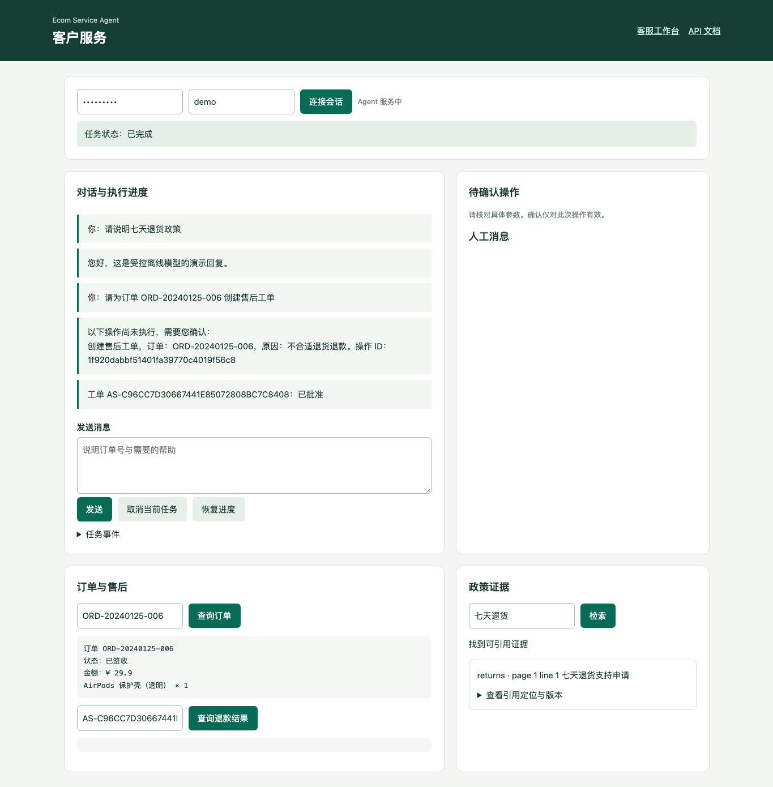
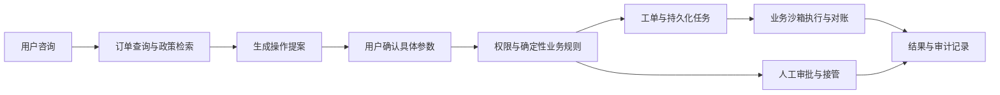

# Ecom Service Agent｜电商售后智能体平台

面向订单咨询与售后处理，将智能体决策、可信操作确认、可恢复业务执行和人工协作整合到同一服务流程中。

用户可以查询订单、检索政策、确认售后操作；客服可以接管会话、审批工单、管理知识版本并查看任务记录。项目重点展示 **Agent 应用开发与后端可靠性工程**，使用合成业务数据和可复现沙箱验证设计。

[五分钟演示](docs/guides/five-minute-demo.md) · [架构](docs/architecture/overview.md) · [验收状态](docs/evaluation/acceptance.md) · [项目贡献](docs/CONTRIBUTIONS.md) · [文档导航](docs/README.md)



*本地受控模型演示，订单与政策为合成数据；截图展示真实 API/Worker 驱动的界面。*

## 一条业务主线



LLM 负责理解、规划和解释；权限、状态转换、幂等约束与敏感操作由确定性代码执行。退款状态未知时进入对账或人工核对，不把超时直接解释成失败后重复退款。

## 核心工程能力

| 能力 | 解决的问题 | 实现与阅读入口 |
|---|---|---|
| 可信工具执行 | 模型生成的参数不能替代用户授权 | 提案绑定身份、参数哈希、有效期；[执行与一致性](docs/engineering/reliable-execution.md) |
| 可恢复业务流程 | 并发请求、进程退出和回调丢失 | 唯一约束、持久化幂等、租约 fencing、Outbox/Inbox、查询对账 |
| 版本化知识 | 政策更新后仍需解释历史回答 | 导入任务、不可变快照、CAS 发布、回滚、稳定引用；[知识与治理](docs/engineering/knowledge-and-governance.md) |
| 模型与配置治理 | 重试费用、配置漂移、灰度不稳定 | 共享 token 配额、调用账本、评测门禁、会话版本固定 |
| 人工协作与可观测性 | 接管时阻止新的自动写操作，定位跨进程故障 | 客服工作台、所有权检查、W3C Trace、审计与故障演练 |

技术栈：Python、FastAPI、Pydantic、SQLAlchemy/Alembic、SQLite/PostgreSQL、MCP Streamable HTTP、OpenTelemetry、Playwright、GitHub Actions。支持 ReAct、Plan-and-Execute 与多 Agent 路由。

## 快速启动

推荐 Python 3.11，在干净检出中创建虚拟环境：

```bash
git clone https://github.com/scallion7/xc_sx_agent.git
cd xc_sx_agent
python3.11 -m venv .venv
source .venv/bin/activate
python -m pip install -r requirements-lock.txt
python -m app.scripts.demo_stack --directory app/sessions/readme-demo
```

Windows PowerShell 使用 `py -3.11 -m venv .venv` 创建环境、`.venv\Scripts\Activate.ps1` 激活环境，随后执行相同的 `python` 命令。

终端打印 `/workspace` 和 `/workbench` 的实际地址，端口动态分配。客户令牌为 `demo-user`，管理员令牌为 `demo-admin`，仅用于本机演示。启动器负责隔离数据库迁移、种子数据、API、Worker、受控 HTTP 模型和库存 MCP 进程，退出时按 `Ctrl+C`。

本地演示无需真实模型密钥或 Docker；首次安装依赖需要网络。五分钟指环境准备完成后的操作时间，逐步流程与预期结果见[演示指南](docs/guides/five-minute-demo.md)。

仅检查启动与任务闭环：

```bash
python -m app.scripts.demo_stack --smoke --directory app/sessions/smoke-demo
```

## 验证证据

最近一次功能与依赖修复验收基线为 [`7d720b6`](https://github.com/scallion7/xc_sx_agent/commit/7d720b6cba0a86663524aeae3a5934dd7d9a3b4c)：

- 本地完整回归 **345 项通过，语句覆盖率 81%**，包含真实 HTTP/MCP 与 Chromium。
- [GitHub Actions 7 个作业全部通过](https://github.com/scallion7/xc_sx_agent/actions/runs/40175352228)：Python 3.10–3.12、SQLite/PostgreSQL 迁移、浏览器、依赖审计、镜像构建和安全扫描。
- 受控 HTTP 模型下完成 540 次两轮任务；它验证工程流程，不代表真实模型效果。
- 保存 Worker 退出、短暂数据库阻断、隔离备份恢复的证据；原始日志与适用边界见[验收状态](docs/evaluation/acceptance.md)。

[当前分支 CI](https://github.com/scallion7/xc_sx_agent/actions/workflows/offline-quality.yml) 与历史证据分别记录，不用旧提交的成功结果替代新提交验收。

## 当前范围

- 真实运行应用、HTTP/MCP、SQL、Worker 和浏览器；模型演示使用受控替身，订单、退款、库存为沙箱。
- Chroma 后端因上游未修复安全公告暂停；默认余弦检索与版本化 SQL 知识平台可用。
- 已验证 PostgreSQL 迁移/smoke 和 Docker 镜像构建/扫描；完整 Compose 部署、PostgreSQL 备份恢复演练仍待验证。
- 真实模型质量、人工金标准、真实支付及生产容量尚未验收。新增平台租户作用域不等同于整个系统已支持共享库 SaaS。

## 阅读与项目背景

- [系统架构](docs/architecture/overview.md)：服务边界、同步与异步链路。
- [配置与运行](docs/guides/configuration.md)：演示、测试、外部服务接入的区别。
- [部署与维护](docs/operations/deployment-checklist.md)：迁移、配置、数据与恢复检查。
- [个人贡献与项目演进](docs/CONTRIBUTIONS.md)：已有原型、工程扩展、提交证据与简历表述边界。
- [历史开发记录](docs/history/README.md)：保留第 1–34 期的设计和阶段验收。

项目从已有电商客服教学原型演进而来，保留其学习记录与技术来源线索。当前首页按业务与工程能力组织；课程分期、历史名称和当时的测试数据在归档中保留。
