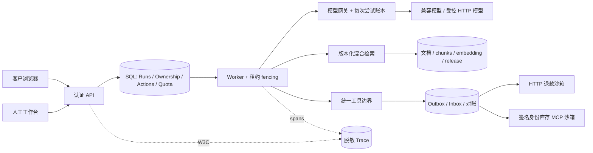

# ADR-002：知识快照、SQL 共享治理和兼容发布

状态：已实现；2026-10-25。

1. **知识索引是不可变发布快照。** 不在活跃向量集合中逐条改数据；先构建完整版本再 CAS head。好处是引用与回滚可追溯，代价是 SQL JSON 快照有规模上限。删除 tombstone 独立于快照，防止回滚恢复被删除的材料。
2. **共享配额使用 SQL。** 复用已经有的事务库，以租户 quota 行序列化检查/预留，再结算每次实际调用。少一个 Redis 依赖，但热点租户吞吐受事务串行化限制；以后可在保持账本语义的前提下替换 admission 层。
3. **配置内容随会话/任务固定。** 模型与风险规则存内容，不只存标签；工具 schema 漂移失败关闭。配置回退只影响新会话，老会话依然固定。知识删除是安全覆盖，仍影响老快照。
4. **人工所有权必须在服务端加锁。** 写动作 claim 和 takeover 共享 SQL 所有权行；最终对外回复落库再次核对。已外发命令不能通过 UI 状态直接撤销，应继续对账。
5. **遥测不承担审计。** OTel 可采样、可清理、可失败；确认、发布、修订和业务状态持久化独立。SQL exporter 用于作品演示，不冒充完整时序数据库。
6. **MCP 不授予信任。** 接入审批固定 schema、权限、读写、大小、超时、限额；模型不提供身份。写库存采用显式适配器和 Outbox，回执不是自然语言“执行成功”。
7. **保留兼容账本。** 第 0006 迁移只扩展；回滚应用而不删除新表。业务数据存在时拒绝 destructive downgrade。恢复到新数据库，比较行数、状态与哈希。

