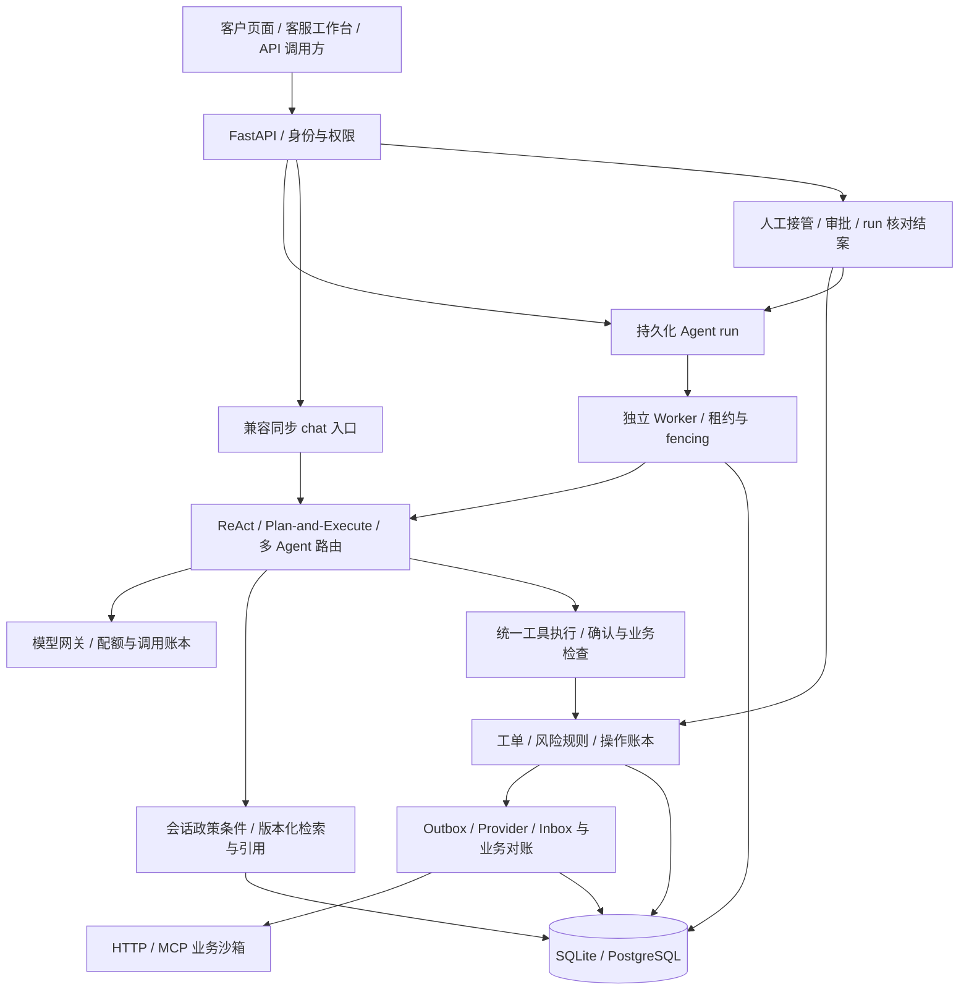

# 系统架构

[文档中心](../README.md) · [当前验收](../evaluation/acceptance.md)

Ecom Service Agent 面向订单咨询和售后处理，提供客户页面、客服工作台、运行管理台及 API。模型负责理解、规划和解释；身份、会话所有权、用户确认和业务状态由服务端决定。模型不直接拥有数据库或支付权限。

## 责任划分

| 层 | 负责 | 代码入口 |
|---|---|---|
| API 与页面 | 鉴权、请求契约、SSE、人工协作入口 | [app/web](../../app/web/)、[app/api.py](../../app/api.py) |
| 身份与安全 | 稳定用户标识、权限、输入输出护栏 | [app/security](../../app/security/) |
| Agent | 理解、工具选择、规划、结果解释 | [app/agent](../../app/agent/)、[app/multi_agent](../../app/multi_agent/) |
| 执行与业务 | 确认、业务状态、幂等、任务恢复 | [app/services](../../app/services/) |
| 知识与治理 | 版本索引、模型预算、配置发布、所有权、Trace | [app/platform](../../app/platform/) |
| 基础设施 | 模型调用、SQL、迁移、仓储实现 | [app/infrastructure](../../app/infrastructure/)、[app/repositories](../../app/repositories/) |
| 沙箱与验证 | 独立服务进程、故障注入、浏览器与业务断言 | [mcp_server](../../mcp_server/)、[tests](../../tests/)、[app/scripts](../../app/scripts/) |

## 身份与数据归属

认证结果中的 `user_id` 用于会话、订单、提案和工单的归属检查。OIDC 默认根据经过验证的精确 `issuer` 和 `sub` 生成稳定、路径安全的 `oidc_` 标识；`preferred_username` 仅作显示名。同名不同主体保持隔离，改名不迁移权限。静态账号不能占用保留的 OIDC 命名空间。

旧版 OIDC 数据若按用户名存储，升级时需要管理员核实主体后配置显式 legacy map。系统不按显示名自动认领旧账号；未映射的历史数据保留，但新身份不会自动获得访问权。映射目标也从静态账号中保留，避免两种认证方式落到同一身份。格式和迁移步骤见[配置指南](../guides/configuration.md)。

平台知识、配置和治理记录使用部署的 `tenant_id`；业务数据还需校验用户与会话范围。当前不是根据任意请求头或模型参数动态选择租户的通用多租户平台。运行核对接口同样检查任务的租户及其业务回执范围。

## 请求与执行路径

客户 workspace 使用 `/v1/runs` 提交持久化任务，Worker 领取后加载固定的运行配置，通过 SSE 展示进度。租约和 fencing 阻止失去所有权的 Worker 提交新的本地状态。兼容入口 `/v1/chat`、`/v1/chat/stream` 仍在请求生命周期中运行，不能等同于持久化队列的恢复保证。

知识查询先确定用户明确提供或所属订单提供的政策条件，再对活动或固定快照检索。显示结果受 `top_k` 限制，但同一已命中政策的适用性和冲突检查覆盖候选上限之外的相关材料。缺证据、条件不全或政策冲突时保守响应。引用可定位不等于自然语言结论已经得到语义验证，详见[知识治理](../engineering/knowledge-and-governance.md)。

写操作先产生绑定参数和业务版本的提案，用户确认后才允许领取执行。远端命令通过持久化操作账本和 Outbox 投递；响应不确定时按稳定业务键查询并对账。退款已结算与 Agent run 已结案是两个状态：`needs_reconciliation` 的 run 需要管理员提交可核验回执才能进入 `resolved`，原任务不会自动重试。详见[可信执行](../engineering/reliable-execution.md)。

浏览器保存尚未确认的请求键及原始请求体，响应丢失后复用原意图；服务端仍承担幂等与授权检查。客服工作台以全局忙碌状态串行化接管、刷新和人工回复，服务端所有权版本检查负责跨客户端竞争。详见[兼容与重试约定](../engineering/naming-and-compatibility.md)和[人工接管](../engineering/human-handoff.md)。

## 可观测性与部署边界

W3C Trace 跨 API、Worker、模型、工具及部分 Provider 传播；确认、发布和结案审计独立持久化，不依赖 Trace 采样。工具 JSON 按结构脱敏，保留数值类型及校验过的 action 控制引用；这避免脱敏破坏后续工具调用，不代表能识别所有敏感信息。

本地演示支持 SQLite，部署与回归也覆盖 PostgreSQL 和 Compose 服务路径；具体环境、脚本、结果和未验收项以[当前验收](../evaluation/acceptance.md)为准。版本化索引仍是 SQL 快照与 Python 精确检索；已完成的受控故障测试不能外推为生产 SLA、真实模型质量或任意规模容量。

历史设计依据见 [ADR-002](../decisions/0002-knowledge-snapshots-and-governance.md)，职责命名及升级要求见[命名与兼容约定](../engineering/naming-and-compatibility.md)。
