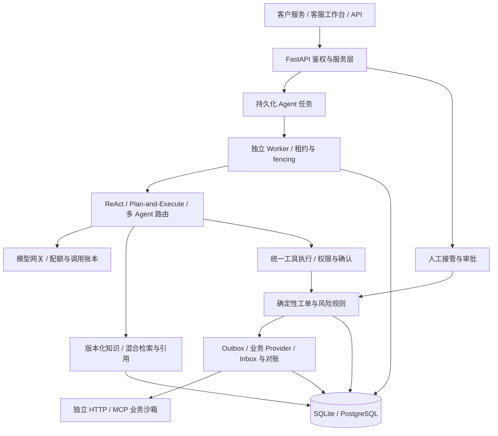

# 系统架构

Ecom Service Agent 面向订单咨询和售后处理。应用提供客户服务、客服工作台、运行管理台及 API；模型不直接拥有数据库或支付权限。

## 责任划分

| 层 | 负责 | 代码入口 |
|---|---|---|
| API 与页面 | 鉴权、请求契约、SSE、人工协作入口 | [app/web](../../app/web/)、[app/api.py](../../app/api.py) |
| Agent | 理解、工具选择、规划、结果解释 | [app/agent](../../app/agent/)、[app/multi_agent](../../app/multi_agent/) |
| 执行与业务 | 确认、权限、业务状态、幂等、恢复 | [app/services](../../app/services/) |
| 知识与治理 | 版本索引、模型预算、配置发布、所有权、Trace | [app/platform](../../app/platform/) |
| 基础设施 | 模型调用、SQL、迁移、仓储实现 | [app/infrastructure](../../app/infrastructure/)、[app/repositories](../../app/repositories/) |
| 沙箱与验证 | 独立服务进程、故障注入、浏览器与业务断言 | [mcp_server](../../mcp_server/)、[tests](../../tests/)、[app/scripts](../../app/scripts/) |

## 两种执行边界

**回答类请求**经 API 入队，由 Worker 加载运行配置，再进行模型调用和知识/订单查询。知识回答附快照、文档版本和 chunk 定位；缺证据、条件不全或政策冲突时保守响应。引用结构存在不等于语义结论一定正确。

**写操作请求**先产生提案，经用户确认后进入确定性业务检查。需要远端执行的命令写入持久化账本/Outbox，通过稳定业务键查询与重试。处理结果尚不确定时进入对账或人工核对。详见[可信执行](../engineering/reliable-execution.md)。

W3C Trace 跨 API/Worker/模型/工具及部分 Provider 传播；业务审计独立持久化，不依赖 Trace 是否被采样。工作台可以接管会话，接管与新的写动作领取争用同一所有权记录。

## 部署与适用规模

一键演示使用 SQLite 和回环服务；CI 验证 PostgreSQL 的迁移与 SQL 合约。版本化索引为 SQL 快照，适用于当前演示规模，不宣称已实现分布式向量数据库。完整 Compose 服务联调及生产规模验证仍需独立验收。

设计依据见 [ADR](../decisions/0002-knowledge-snapshots-and-governance.md)，实际完成情况见[验收状态](../evaluation/acceptance.md)。
