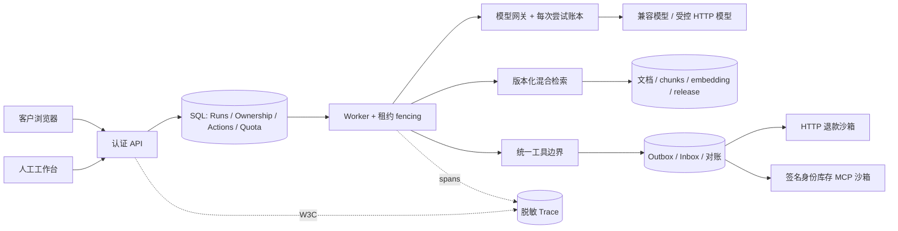

# ADR-002：知识快照、SQL 共享治理和兼容发布

[文档中心](../README.md) · [当前验收](../evaluation/acceptance.md)

状态：已实现；2026-10-25。

1. **知识索引是不可变发布快照。** 不在活跃向量集合中逐条改数据；先构建完整版本再 CAS head。好处是引用与回滚可追溯，代价是 SQL JSON 快照有规模上限。删除 tombstone 独立于快照，防止回滚恢复被删除的材料。
2. **共享配额使用 SQL。** 复用已经有的事务库，以租户 quota 行序列化检查/预留，再结算每次实际调用。少一个 Redis 依赖，但热点租户吞吐受事务串行化限制；以后可在保持账本语义的前提下替换 admission 层。
3. **配置内容随会话/任务固定。** 模型与风险规则存内容，不只存标签；工具 schema 漂移失败关闭。配置回退只影响新会话，老会话依然固定。知识删除是安全覆盖，仍影响老快照。
4. **人工所有权必须在服务端加锁。** 写动作 claim 和 takeover 共享 SQL 所有权行；最终对外回复落库再次核对。已外发命令不能通过 UI 状态直接撤销，应继续对账。
5. **遥测不承担审计。** OTel 可采样、可清理、可失败；确认、发布、修订和业务状态持久化独立。SQL exporter 用于作品演示，不冒充完整时序数据库。
6. **MCP 不授予信任。** 接入审批固定 schema、权限、读写、大小、超时、限额；模型不提供身份。写库存采用显式适配器和 Outbox，回执不是自然语言“执行成功”。
7. **保留兼容账本。** 第 0006 迁移只扩展；回滚应用而不删除新表。业务数据存在时拒绝 destructive downgrade。恢复到新数据库，比较行数、状态与哈希。

## 实施更新：2026-11-10

以上保留 2026-10-25 的决策及当时的架构图。以下记录后续实现对边界的补充，不表示这些机制在原决策日期已经全部具备，也不替代当前验收证据。

- **身份不再依赖显示名。** OIDC 以验证后的精确 `issuer` / `sub` 生成稳定内部标识；`preferred_username` 仅用于显示。旧账号通过经管理员核实的显式映射继续访问，禁止自动按用户名认领；静态账号不能占用 OIDC 或映射目标身份。详见[身份升级约定](../engineering/naming-and-compatibility.md)及[配置指南](../guides/configuration.md)。
- **快照安全判断独立于展示数量。** 政策条件记录用户消息或所属订单来源，并按用户会话恢复；换单、否定和冲突会清除或阻断旧条件。同一已命中政策的冲突检查覆盖 `top_k` 和候选池之外的适用材料。删除覆盖仍然生效。这依赖结构化元数据与保守来源规则，不构成通用语义冲突识别。详见[知识治理](../engineering/knowledge-and-governance.md)。
- **运行结案依赖业务回执。** 写调用在分发前绑定 action；`needs_reconciliation` 只有在全部写调用证据、业务终态及投递状态满足要求后，才能通过 CAS 进入 `resolved`。结案和审计同事务，原任务不自动重放；旧日志没有可绑定回执时仍阻断。详见[可信执行](../engineering/reliable-execution.md)。
- **撤销旧授权不阻塞新申请。** 已拒绝、失效或过期的普通提案可以被新提案替代，但新 action 需要重新确认，旧 action 保持不可执行。接管再释放不恢复旧 run 或授权。工作台以全局忙碌状态覆盖接管和刷新，服务端所有权锁继续负责跨客户端竞争。详见[人工接管](../engineering/human-handoff.md)。
- **脱敏与恢复保留结构。** 工具 JSON 递归脱敏字符串，保留数值类型及合法 action 控制引用。浏览器保存未确认请求的原始 payload 与幂等键；明确的申请版本拒绝可以释放请求，未知冲突和网络错误仍保留待核对意图。详见[对话与证据处理](../engineering/improvement-loop.md)及[请求兼容约定](../engineering/naming-and-compatibility.md)。

第 7 项中的 `0006` 是原决策对应的迁移，不是当前迁移头。后续新增数据集、候选、admission 锁和派生索引的迁移见[扩展与迁移说明](../engineering/improvement-loop.md)。最新架构见[系统架构](../architecture/overview.md)；测试环境、结果及未完成的生产和真实模型验证统一见[当前验收](../evaluation/acceptance.md)。
