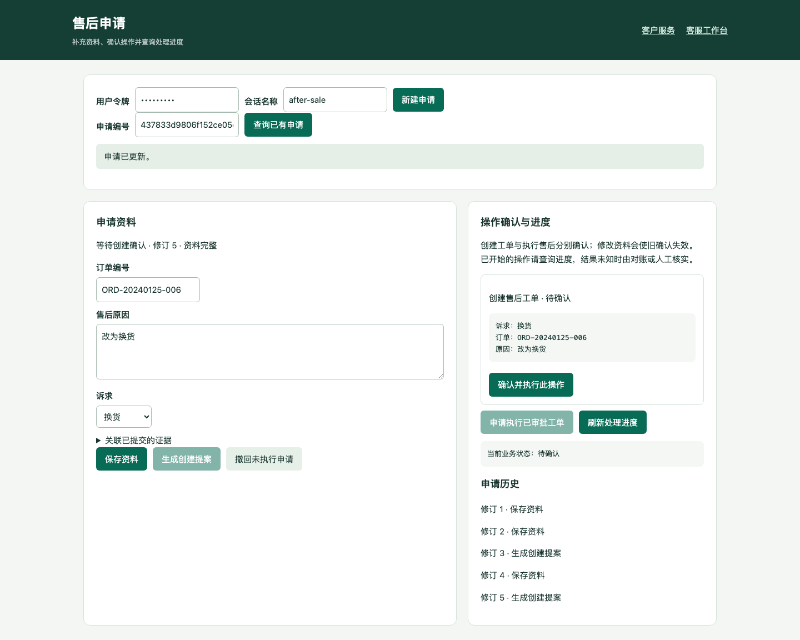

# 检索实验、人工接管与复杂售后流程

2026-11-05，基于 `b2df06d` 的第二、三轮开发。以下记录为提交前完成的本地验收；不使用付费模型，不代填人工复核，不运行冻结保留集。

## 第二轮：可复现的检索实验

```bash
python -m app.scripts.compare_retrieval \
  --baseline app/evaluation/retrieval_profiles/legacy-v1.json \
  --candidate app/evaluation/retrieval_profiles/candidate-v2.json \
  --output test-results/retrieval-comparison.json
```

`RetrievalProfile` 是不可变、有校验的实验配置，包含 tokenizer 版本、Unicode NFKC 规范化、候选池大小、RRF 参数/权重、词法重排权重和证据支持门槛。完整配置参与 SHA256 与缓存键；同名配置改参数也不会共享旧缓存。支持的 tokenizer 当前仍只有既有版本，不能填写任意名称伪装切换分词器。

默认配置保留原检索行为。候选 v2 仅增加 NFKC 规范化和 20 条候选池：先召回候选，再按原证据门槛过滤，最后截取 top K，从而允许候选池内的合格证据递补。没有自动降低门槛或上线候选配置。测试以受控排序复现“第一候选被拒、后续合格证据应递补”的机制。

对比使用同一知识快照、同一批 development 题目与四种模式，独立统计候选召回、最终证据召回、结果状态、错误放行、无依据引用及不必要拒答。缺失证据归因分为：索引缺失、适用性过滤、无正分、候选池之外、证据筛选拒绝、最终 top K 之外。逐题报告标识变化、改善与退化，并保存两侧完整诊断轨迹、配置哈希、原始文件哈希与代码树哈希。

本次 16 题 × 4 模式 = **64 组配对比较**，使用尚未人工审核的初始标签：

| 观测 | 基线与候选结果 |
|---|---|
| BM25 / hybrid 候选召回 | 均为 100%，只在有预期证据的题上计算 |
| 本地哈希向量候选召回 | 均为 92.9% |
| 最终证据召回 / 状态准确率 | 四模式均为 42.9% / 50.0% |
| 输出变化、改善、退化 | 64 组均无变化 |
| BM25 / hybrid 缺失证据归因 | 9 次文档实例被证据门槛拒绝；不是 9 个独立业务家族 |

这批数据的主要损失位于证据判断阶段，扩大候选池没有改善其最终表现。**本轮交付实验闭环和可解释的失败定位，不声称语义质量提升。** 原始标签仍需真实审核，再决定如何调整证据策略。[摘要](../evidence/retrieval-handoff-round2/comparison.json)关联完整压缩轨迹。实验入口只接受 development，报告始终 `release_eligible=false`；`--review` 可应用全量审核通过的标签，但不会解锁本脚本对 holdout 的运行。

## 第二轮：接管后的执行与成本控制

任务提交时保存会话所有权版本。Worker 创建 Agent 前检查所有权，每次模型/工具调用登记 `call.started` 时在 SQL 事务中再次检查并锁定该版本；最终回复提交也检查版本。人工接管再释放会增加版本，旧任务不能因为当前状态重新变成 agent 而继续旧诉求。

已接管或版本已变更的任务不创建 Agent，不产生新的模型账本记录；保留用户输入和 `run.handoff` 事件。为兼容已有任务 API，任务终态仍为 `completed`，结果 `reply=""`、`requires_human=true`、`evidence_state="awaiting_human"`，内部记录 `requires_new_request=true`。这表示已完成交接，不表示原业务诉求已经执行。人工释放后必须由用户提交新请求，不自动恢复旧授权；新请求会读取保存的会话上下文。

调用登记完成后与外部网络之间存在不可消除的窗口，因此已经登记的请求按在途处理，仍可能执行并产生费用；随后禁止新调用。已返回但不能发送的回复仍保存在内部草稿，保持原审计兼容。未知的写副作用仍进入 `needs_reconciliation`，不能当作普通接管完成。

相同 18 项冻结离线任务全部通过；三种策略在“先接管、后提交”场景的模拟调用数由 **3 / 3 / 4 降为 0 / 0 / 0**。整个矩阵模拟 usage 由 **2010 降为 1710 tokens**，差值 300；这是受控服务用量，不是实际账单。[本轮任务报告](../evidence/retrieval-handoff-round2/task-baseline.json)与[上一轮报告](../evidence/review-round1/task-baseline.json)使用相同任务文件。

## 第三轮：持久化售后申请

启动现有离线演示，打开终端打印的 `/after-sale`：

```bash
python -m app.scripts.demo_stack --directory app/sessions/intake-demo
```

使用 `demo-user` 新建申请，分次填写订单与原因，生成创建提案，核对具体参数后“确认并执行”。需要人工审批的工单审批后，再生成执行提案并重新确认。材料通过已有 `/v1/evidence` 提交、由管理员审核；本版页面可关联已提交的材料编号，尚未实现图片存储或自动理解证明材料。



申请使用两张新表：`after_sale_intakes` 保存当前资料和修订，`after_sale_intake_events` 保存命令哈希、完整回执和服务端时间。所有记录绑定配置 tenant 和认证用户；请求体不能传入审核身份、可信确认布尔值或退款金额。金额仍由订单和业务规则决定。

| 接口 | 作用 |
|---|---|
| `POST /v1/after-sale-intakes` | 使用 `session_id` 和 `Idempotency-Key` 创建/找回申请 |
| `GET /v1/after-sale-intakes/{id}` | 读取申请、当前提案、真实工单和退款操作状态 |
| `GET /v1/after-sale-intakes/{id}/history` | 读取本用户的修订与命令回执 |
| `POST /v1/after-sale-intakes/{id}/commands` | 提交 `update`、`propose`、`propose_execution`、`withdraw`，必须携带 `expected_revision` 与 `Idempotency-Key` |

`update` 的字段为 order_id、reason、case_type、evidence_ids。订单变化时默认清空旧证据引用；生成提案时核验材料归属及订单、规则、证据快照。提案创建与申请修订/回执同事务提交；修改或撤回也与旧提案失效同事务提交。响应丢失后重试原键返回原修订回执，不重复修改；同键不同内容拒绝。并发使用不同键修改旧修订时，失败方刷新后重新核对。

创建与执行沿用 `/v1/actions/{id}/confirm` 和 `/execute`，不会因保存资料或生成提案产生工单/退款。修改已确认但尚未执行的申请会使原确认失效；新提案须重新确认。已经执行或结果未知的创建操作禁止原地改写/撤回。已创建工单的诉求变更仍需业务审核处理，**本版不支持直接改写已审批工单或撤销已经发生的退款**。

`status` 描述申请资料和提案阶段；`business_state` 从工单、退款操作实时派生。特别是幂等重放可能返回原始“已受理”回执，最新退款结果必须查询业务状态，不能把该回执当作失败再退款。

本轮是结构化申请流程与业务执行契约，复用原有 Agent 工具的确认、快照和业务服务。没有新增未经评测的自然语言槽位提取能力；真实模型如何完成复杂多轮对话，留待后续真实模型评测验证。

## 三条真实 HTTP 业务验收

```bash
COMPLEX_TASK_REPORT_DIR=test-results/complex \
  python -m unittest tests.test_complex_after_sale_http -v
```

使用独立应用与商务沙箱数据库、真实 API/供应商 HTTP，以及生产退款投递/对账 Worker 代码，不依赖模型回复判断成功。

| 场景 | 验证结果 |
|---|---|
| 多轮资料、补证、审批 | 缺订单/原因时不能提案；证据审核变更使旧确认失效；新提案创建待审工单；未审批不能生成执行提案；过期审批版本拒绝；最终 1 工单、0 退款操作、0 供应商退款 |
| 诉求修改与撤回 | 修改使已确认旧提案失效，新提案须重新确认；撤回阻止执行；最终工单/退款操作/供应商退款均为 0 |
| 退款结果未知与恢复 | 提交后断连且丢失回调，查询显示 unknown；重放复用原操作；供应商重启后查单对账成功；最终 1 工单、1 操作、1 供应商退款 |

原始 HTTP 轨迹与终态：[补证审批](../evidence/complex-after-sale-round3/multiturn-evidence-approval.json)、[变更撤回](../evidence/complex-after-sale-round3/changed-request-withdrawal.json)、[未知结果恢复](../evidence/complex-after-sale-round3/unknown-refund-recovery.json)。三条业务工作流不是额外三种模型能力评分，不与 18 项受控 Agent 矩阵混为一个成功率。

## 迁移、测试与验收范围

已有数据库启动新版本前执行 `python -m app.scripts.manage_migrations upgrade`，新增迁移 `20261105_0008`；旧迁移保持不变。已有售后申请或回执时拒绝降级，不能为降级删除真实历史。SQLite 空库升级、drift、专用租户 smoke、降级与重建已验证，[迁移日志](../evidence/complex-after-sale-round3/sqlite-migration.log)可复查；既有真实业务数据库未自动迁移。

第二、三轮合并本地回归 **408 项通过、无跳过，77.286 秒，app 语句覆盖率 82%**，含 Chromium、HTTP/MCP、供应商重启和故障恢复。另行完成最终售后页面复测。OpenAPI 95 个路径、Ruff、编译、计划质量检查通过。覆盖率不含脚本和独立进程，任务报告独立保存证据。

CI 配置已新增浏览器/实验检查及 SQLite/PostgreSQL 申请流程 smoke。本文与 `checks.json` 保留提交前的本地验收快照；**本地验收不覆盖本轮 PostgreSQL 和 Compose**，其结果以对应提交的 GitHub Actions 为准，不能沿用 `b2df06d` 的 8/8 通过结论。付费模型、真实人工金标准、独立 holdout 和生产支付仍未验证。
