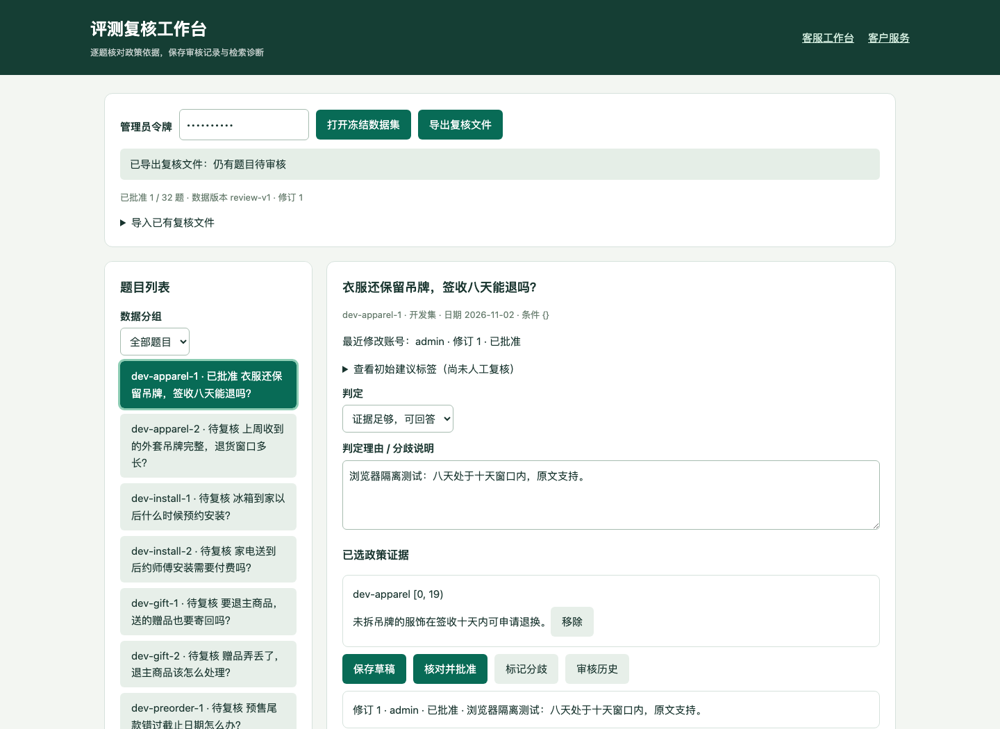

# 检索诊断、人工复核与任务级基线

本页记录第一轮交付。第二、三轮本地改动见[检索实验、接管与复杂售后](../engineering/retrieval-handoff-and-intake.md)，其中已补齐接管前置检查；下文 2010 tokens 等数字保留第一轮口径。

本轮交付三个可独立复现的能力：解释检索每个阶段的决策，保存可信的人工审核过程，以及用真实 HTTP/Worker 和业务状态判断任务是否完成。全程使用本地哈希投影与受控 HTTP 模型，不调用付费服务。当前原始检索语料仍为 **18 份合成政策、32 道未人工审核题目**；保留集未运行。

## 开始使用工作台

```bash
python -m app.scripts.demo_stack --directory app/sessions/review-demo
```

打开终端打印的 `/review`，输入 `demo-admin`。此令牌仅用于本机可丢弃演示；实际部署使用现有管理员认证，接口要求 `maintenance:run` 权限。生产维护者应先执行 `python -m app.scripts.manage_migrations upgrade`，新增版本 `20261105_0007` 包含 `review_projects`、`review_annotations`、`review_events`，不修改既有业务表。



*截图来自自动化浏览器的可丢弃测试库；其中批准记录不计入项目真实人工复核进度。*

1. 打开冻结数据集，选择题目。先核对问题、日期、适用条件与原始政策；初始建议标签折叠显示，避免直接照抄。
2. 点击“采用此政策”保存原文及 `[start, end)` 字符定位（按 Unicode 字符计数），填写结果判定与理由。当前界面引用政策全文，API 支持原文片段定位。
3. 保存草稿、核对并批准，或标记分歧。批准必须提供非空理由；除 `no_evidence` 外，必须为所有 gold 政策提供精确匹配的原文证据。无证据结论必须清空 gold 并说明原因。
4. “审核历史”查看认证账号、修订与理由。两个窗口编辑同一旧版本时，仅第一个保存成功；另一个返回 `REVIEW_VERSION_CONFLICT`，重新选择题目读取新版本，再人工合并意见。
5. 导出 JSON，保存原始文件。导出绑定题目和文档哈希，保留账号、UTC 时间、修订、证据与批准状态。**导入只生成草稿**，不继承外部文件声称的身份或批准；完整验证后同事务写入全部 32 题。导入前先导出备份，已有审核历史保留。

项目与记录按配置中的 tenant 隔离；这不代表整套旧业务系统已成为共享库 SaaS。令牌不存入浏览器 localStorage；切换令牌会清空页面资料。审计历史在应用中仅追加，没有修改接口；它不等同于防数据库管理员篡改的签名日志。共享管理员令牌只能标识共享账号，真实组织需使用独立身份。

有复核项目或历史记录时，迁移降级会返回 `REVIEW_DOWNGRADE_BLOCKED`。应保留备份及审计数据，不能为降级随意清空真实审核表。CI 的降级测试仅清理专用 smoke 租户的数据。

## 检索诊断如何读

```bash
python -m app.scripts.review_evaluation --diagnostics \
  --output test-results/retrieval-development.json
```

页面选择 development 题目后也可运行本题诊断。诊断调用与公开检索相同的 `_search`，绕过缓存，额外保存：查询分词、日期和条件、删除/时效/适用范围原因、BM25 与向量分数和名次、RRF/重排前后分数、最终名次、词法重叠门槛、被拒候选及结果状态。公开检索响应不增加内部诊断字段。

“缺少 region/channel/product”表示需要澄清，未必被过滤；`lexical_support_rejected` 表示候选已有正分，但没有通过本地哈希投影的词法支持门槛。BM25 模式没有计算向量分数，因此诊断中的该列为 0，不能当作独立向量实验结果。

本轮对 **16 道开发题** 的实测：

- 15 题四模式最终有序结果与状态完全相同；`dev-conflict-1` 的向量模式交换了两条冲突证据的顺序，其他模式顺序相同。
- 四种模式仍为 Recall@K 42.9%、MRR 0.375、状态准确率 50.0%，没有检索质量提升结论。
- 各模式都有 9 题输出 `no_evidence`；候选级词法门槛拦截分别为 vector 50、BM25 36、hybrid 52、hybrid+rerank 52 次。计数单位是候选，不是失败题目，也不能单靠它决定降低门槛。

[摘要](../evidence/review-round1/retrieval-diagnostics.json)关联压缩原始轨迹与 SHA256。本轮增加诊断，不调整 tokenizer、排名权重或门槛；下一步应由真实复核确认标签及拒答边界，再使用 development 做受控改进。

保留集预测接口与 CLI 都要求全体 32 题批准；待复核时在构建检索器前拒绝请求。冻结文件不修改。完成真实审核后使用导出文件运行：

```bash
python -m app.scripts.review_evaluation --split holdout \
  --review test-results/review.json --diagnostics \
  --output test-results/holdout.json
```

文件校验不等同于签名认证；不要自行填写虚假 reviewer 来解锁。第一次 holdout 结果完整归档，此后不要把反复用于调参的数据称为独立保留集。

## 任务级基线

```bash
python -m app.scripts.evaluate_tasks --output test-results/task-baseline.json
```

任务定义及哈希见 [tasks](../../app/evaluation/tasks/)。每项任务、每种策略都启动独立 SQLite、API、Worker、受控 HTTP 模型进程。初态为空工单/退款操作，执行真实接口后，独立 grader 对照冻结期望检查终态，不能以回复文本里的“成功”判定通过。策略为 ReAct、Plan-and-Execute、multi 路由，共 18 项。

| 任务 | 关键断言 |
|---|---|
| 政策追问 | 同会话两轮，工具实际执行、引用能回查当前知识版本，工单与退款操作数为 0 |
| 确认与重放 | 确认前没有工单；确认后执行成功；重复执行返回相同业务结果并标明幂等重放；唯一工单属于预期用户/订单 |
| 拒绝提案 | 拒绝后执行被阻止，无工单或退款操作 |
| 文本伪确认 | 消息中的 `user_confirmed=true` 不构成可信确认；未确认 API 执行被阻止，无副作用 |
| 用户隔离 | 另一用户读取任务与事件均返回 404，无业务写入 |
| 人工接管 | 自动回复为空，人工消息重复请求只产生一条，工单和退款操作数为 0 |

每项同时检查实际持久化 `call.started` 中的读写工具名称、允许工具和必要工具覆盖。人工接管当前允许后台只读工具：本轮三种策略仍分别产生 3/3/4 次模拟模型调用，不能称为“接管后零模型消耗”；进一步提前停用 Agent 属于后续优化。伪确认任务使用受控模型固定行为，验证接口闭环，不能代替真实模型提示注入红队测试。

本轮 **18/18 通过，模拟 usage 合计 2010 tokens，付费调用 0**。摘要包含每项断言、失败分类、耗时和模拟用量；压缩原始文件包含 HTTP 响应、真实队列事件、模型请求/响应、SQL 调用账本与业务初终态。记录代码树哈希、冻结输入和锁文件哈希、基础提交及离线配置，SHA256 连接摘要和原始证据。耗时包含启动开销，不是线上延迟。

可显式设置 `--max-trials`（上限 18）和 `--token-budget`（上限 100000）；SQL 共享配额在调用前预留。报告缺项、重复、断言失败或预算不足均不能通过，CLI 非零退出并保留报告。未知异常保守计入剩余预算并停止，避免静默漏算。**任务矩阵属于合成开发契约，`release_eligible=false`，不能直接送入发布门禁或作为真实模型成功率。**

## 检查与边界

本地 385 项全量测试、18 项独立 HTTP 基线及 SQLite 迁移已完成；新增复核 SQL smoke 同时进入 SQLite/PostgreSQL CI，浏览器 CI 会运行真实 Chromium。参见[验收汇总](acceptance.md)。既有 CLI、公开检索、业务 API、原始语料与旧迁移保持兼容；新导出格式增加更严格的原文校验，旧人工 JSON 入口仍保留。

后续真实工作包括：本人/独立复核者完成金标准、对 development 做可解释检索改进、另行授权真实 embedding/模型评测，以及在人工接管状态下进一步减少无效模型调用。本轮没有替代这些人工或外部服务验证。
