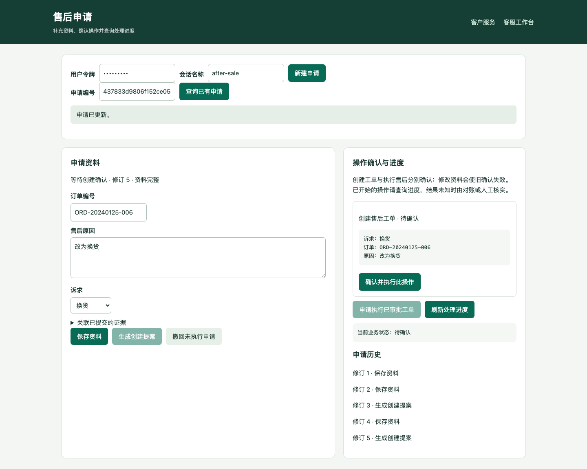

# 售后申请：补资料、确认与核对

[文档中心](../README.md) · [当前验收](../evaluation/acceptance.md)

本页说明 `/after-sale` 表单、对话草稿和接入 API 的操作契约。服务端的授权与一致性设计见[可信执行](../engineering/reliable-execution.md)，故障处理见[恢复手册](../operations/incident-runbook.md)。

## 表单办理

完成[依赖安装](configuration.md)后，使用新的演示目录启动：

```bash
python -m app.scripts.demo_stack --directory app/sessions/intake-demo-01
```

打开终端打印的 `/after-sale`，输入 `demo-user`。这套本机演示使用合成订单和 mock 商务 Provider；独立 HTTP 商务沙箱另见[完整部署验收](../operations/compose-acceptance.md)。

1. 输入会话 ID，新建申请并记下申请编号。
2. 分次填写订单 `ORD-20240125-006`、原因、诉求类型和材料编号，点击“保存资料”。未补齐的字段会列在处理进度中。
3. 资料完整后生成创建提案，核对参数，再点击“确认并执行此操作”。保存资料或生成提案本身不创建工单，也不退款。
4. 需要人工审批的工单由客服审批；达到 `approved` 后生成执行提案，重新确认执行。创建工单的授权不能代替执行授权。
5. 刷新处理进度，分别查看申请修订、工单和退款操作状态。历史回执与最新业务结果可能不同，应以当前业务状态为准。

创建、读取、保存以及随后刷新期间，相关字段和按钮暂时禁用，避免迟到的响应覆盖新输入。材料由 `/v1/evidence` 提交，再由管理员审核；页面可以关联已有材料 ID，本版没有图片上传存储或自动理解证明材料。



## 区分冲突与结果未知

| 返回或提示 | 含义 | 下一步 |
|---|---|---|
| HTTP 409，`INTAKE_VERSION_CONFLICT` | 其他页面已推进修订，本次命令没有提交 | 刷新处理进度，核对最新资料，重新编辑并保存；旧命令意图已释放 |
| 网络中断、响应无法读取或 HTTP 5xx | 客户端不能确定服务端是否已提交 | 使用“重试上次提交”，保留原请求编号、原修订和原内容 |
| 其他 HTTP 409 | 可能是同键冲突、业务状态变化或授权冲突 | 保留待核对提交，查询申请及历史，按错误码处理；不能一律当成未提交 |
| 当前 action 为 `executing` / `unknown` | 该操作已经开始或结果不确定 | 查询工单和操作状态，不生成新授权反复执行 |

待核对命令保存在当前浏览器标签页的 `sessionStorage`，按令牌作用域、路径和申请隔离。页面重载后，输入原令牌并查询原申请，“重试上次提交”仍重放原始内容；刷新得到的新修订不会被拼入旧请求。它不是跨浏览器或永久存储，关闭标签页前先记下申请/任务 ID。

核对完成后再提交新修改。后台以幂等回执先于修订比较的顺序处理原键重试：已经提交的命令返回原回执；同键换内容则拒绝。不要清空浏览器存储或改键来掩盖未知结果。

“确认并执行”使用 action ID 及参数哈希约束，独立于表单命令的 `Idempotency-Key`。若确认/执行的响应丢失，先刷新该申请和 action；已完成的操作读取既有结果，在执行或未知的操作进入查询核对。

## 修改、撤回与业务结果

创建提案后修改资料或撤回，会使尚未执行的旧提案失效；新参数必须重新生成并确认。订单变化时默认清空旧材料引用；显式提交的材料仍须匹配用户和订单。

已执行或结果未知的创建操作禁止原地改写/撤回。已创建工单的诉求变更需要业务审核处理；本版不能直接改写已审批工单，也不能通过撤回申请撤销已经发生的退款。

`status` 表示申请资料/提案阶段，`business_state` 从关联工单及退款操作派生。历史“已受理”回执不等于退款成功，也不等于失败：HTTP 沙箱的 `unknown`/`needs_reconciliation` 须按原业务键查询供应商，不能重新退款。

Agent 对话任务与退款操作是两个状态机。若退款已经核对成功而对话仍为 `needs_reconciliation`，管理员还须读取 `/v1/admin/runs/{run_id}/reconciliation`，核验凭证后调用 `/resolve`。结案状态 `resolved` 释放原会话但不重放旧任务；无法关联可信凭证的旧记录仍阻断。完整步骤见[人工结案](../operations/incident-runbook.md#agent-任务人工核对结案)，表单和客服工作台当前没有强制解锁按钮。

## API 契约

所有记录绑定部署配置中的 tenant 和认证用户；客户端不能指定审核人、可信确认布尔值或退款金额。

| 接口 | 请求约束与结果 |
|---|---|
| `POST /v1/after-sale-intakes` | `session_id` 与 `Idempotency-Key`；创建或返回该命令的原申请 |
| `GET /v1/after-sale-intakes/{id}` | 返回本用户申请、当前提案、关联工单和操作状态 |
| `GET /v1/after-sale-intakes/{id}/history` | 返回本用户的修订与命令回执 |
| `POST /v1/after-sale-intakes/{id}/commands` | `command`、`expected_revision`、`Idempotency-Key`；命令为 `update`、`propose`、`propose_execution`、`withdraw` |
| `POST /v1/actions/{id}/confirm` | `session_id` 与 `arguments_hash`，确认具体动作 |
| `POST /v1/actions/{id}/execute` | `session_id`，消费该动作已获确认的授权 |
| `GET /v1/after-sales/{case_id}/operation` | 查询本用户工单的最新退款操作状态 |

只有 `update` 可携带 `fields`，支持 `order_id`、`reason`、`case_type`、`evidence_ids`。生成提案时校验材料归属、订单、规则与证据快照；申请修订、旧提案失效和完整命令回执同事务提交。并发修改旧修订的失败方必须重新核对，不自动合并资料。

`after_sale_intakes` 保存当前资料和修订，`after_sale_intake_events` 保存命令哈希、完整回执和服务端时间。前端禁用按钮只是交互保护，服务端的修订、授权与幂等约束在直接 API 调用时仍然生效。

## 在对话中分轮办理

```bash
python -m app.scripts.demo_stack --intake --directory app/sessions/dialogue-demo-01
```

在 `/workspace` 依次发送“售后申请”“补充订单 ORD-20240125-006”“补充原因：尺寸不合适”“生成提案”，每轮等待完成。缺资料时追问；确认前“改为换货”会使旧提案失效，再次生成才能确认。未执行业务前可“撤回申请”，之后“新申请”建立独立草稿。

这些是受控模型的确定性演示用语，不能证明真实模型抽取质量。开启功能后，服务端校验字段来源、修订、任务租约与人工接管版本。客户可通过 `GET /v1/sessions/{session_id}/after-sale-intakes` 查看本会话资料；客服工作台的“查看申请资料”读取已保存状态。

客服接管并刷新待办时，页面操作和目标输入保持禁用；必须等完整刷新结束，核对用户/会话，再审批或发人工回复。接管阻断新的自动写操作，已经在途的业务仍须核对。

## 升级与回归

已有数据库先备份，再执行 `python -m app.scripts.manage_migrations upgrade` 升至 head（当前 `20261109_0009`），并检查迁移状态。申请表最初来自 `20261105_0008`；不要只升到该历史修订，也不要修改旧迁移或删除业务回执来完成降级。

当前回归入口：[表单浏览器](../../tests/test_intake_browser.py)、[对话草稿](../../tests/test_dialogue_intake.py)、[复杂售后 HTTP](../../tests/test_complex_after_sale_http.py)、[人工任务结案](../../tests/test_run_reconciliation.py)。执行方式见[配置与运行](configuration.md)，提交与 CI 结果见[当前验收](../evaluation/acceptance.md)。

[历史迁移日志](../evidence/complex-after-sale-round3/sqlite-migration.log)保留当时的验证范围；[任务基线](../evaluation/task-baseline.md)说明补证审批、变更撤回和退款未知恢复场景，不据历史材料声称真实业务库已迁移。
