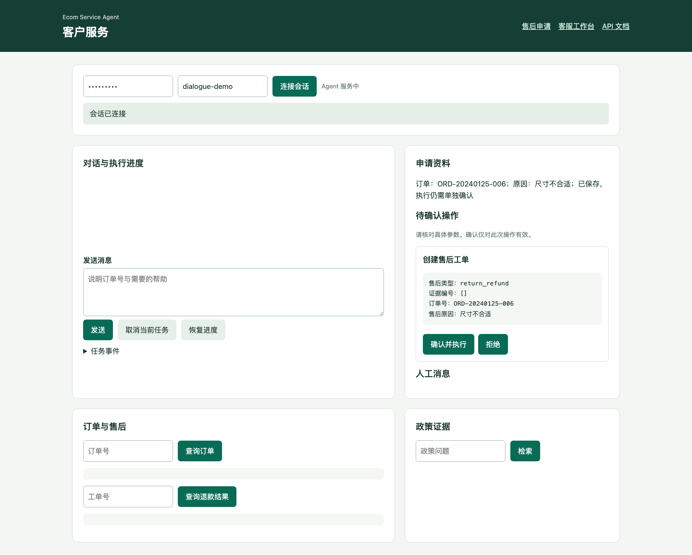
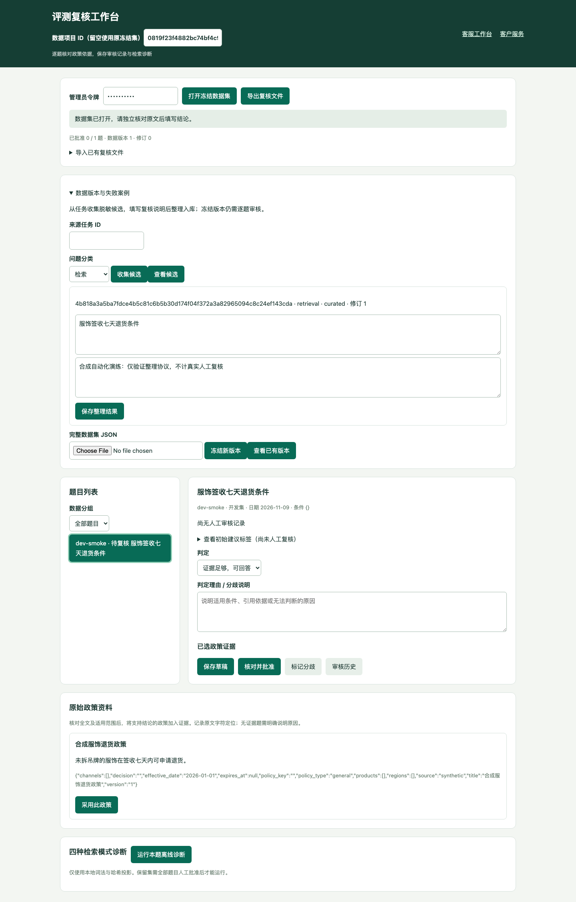

# 五分钟演示

[文档中心](../README.md) · [当前验收](../evaluation/acceptance.md)

展示一条可观察的业务主线：查订单和政策、分轮补齐申请、确认具体操作、人工接管。五分钟从环境准备完成后计时；首次下载依赖与浏览器不计入演示。

## 启动与页面

按照[配置与运行](configuration.md)准备 Python 3.11 虚拟环境，在干净检出的仓库根目录执行：

```bash
python -m pip install -r requirements-lock.txt
python -m app.scripts.demo_stack --intake --directory app/sessions/interview-demo-01
```

每次展示使用新目录，避免前一场的工单、会话和配额影响结果。启动器自动迁移隔离数据库、导入合成知识并启动 API、Agent Worker、受控 HTTP 模型及库存 MCP，终端打印动态端口地址：

| 页面 | 用途 | 本机演示令牌 |
|---|---|---|
| `/workspace` | 客户对话、订单、政策证据、操作确认 | `demo-user` |
| `/workbench` | 客服接管、审批、知识版本与诊断 | `demo-admin` |
| `/after-sale` | 表单方式分次补资料和核对处理进度 | `demo-user` |
| `/review` | 评测复核与数据版本演示 | `demo-admin` |

客户会话使用 `demo`。令牌只属于这套演示；使用终端打印的完整 URL，不假定端口是 8000。该启动器的商务 Provider 为 mock，不启动 HTTP 退款沙箱，也不调用付费模型或真实支付。完整独立沙箱与恢复流程另见[Compose 验收](../operations/compose-acceptance.md)。

仅验证启动闭环时可加 `--smoke`；它完成一个政策任务便退出，不能用于保持浏览器页面运行。`--intake` 开启对话草稿；即使不加该参数，`/after-sale` 表单仍可使用。

## 0:00–1:00：连接与订单查询

打开 `/workspace`，输入 `demo-user` 和会话 ID `demo`，点击“连接会话”。在“订单与售后”输入 `ORD-20240125-006` 并查询。

预期看到该合成订单的状态、金额和商品。说明自然语言交互与业务身份校验的职责：订单归属由服务端判断，模型不能声明自己属于另一账户。

## 1:00–2:00：政策与引用

发送 `请说明七天退货政策`，等任务完成；再在“政策证据”输入 `七天退货` 并检索，展开引用定位与版本。

预期看到适用原文、文档版本和 chunk 定位。受控模型回复用于演示协议，重点展示证据如何关联到回答；不要将其作为真实模型理解或检索质量成绩。

## 2:00–3:30：分轮资料与单独确认

依次发送，每条都等待任务完成：

1. `售后申请`
2. `补充订单 ORD-20240125-006`
3. `补充原因：尺寸不合适`
4. `生成提案`

观察缺资料追问、侧栏保存的申请与来源、待确认卡中的具体参数。核对订单、原因和诉求后，点击一次“确认并执行”，记录返回的工单编号。

保存草稿与生成提案都不会创建退款。此步骤确认的是创建工单；需要审批的工单仍须审批，执行工单另需一份确认。可选地在确认前发送“改为换货”，展示旧确认失效，再重新生成提案；不要在已执行业务后声称能直接改写或撤销退款。

## 3:30–4:30：接管与人工回复

在 `/workbench` 输入 `demo-admin`，点击“刷新待办”，找到 `user-1 / demo` 并点击“接管”。等待状态提示“待办已刷新”，确认回复目标的用户和会话，再输入 `人工处理完成，请留意后续通知。` 并发送。

接管请求和其后的待办刷新完成前，工作台按钮、令牌、会话与输入框都保持禁用；刷新中生成的新控件也暂不可操作。等控件恢复后再继续，避免把尚未切换目标的回复误发到上一会话。

回到客户页点击“连接会话”刷新，预期显示“人工服务中”并出现人工消息。接管会阻止旧任务登记新的自动调用，已登记的在途请求仍可能产生结果。人工回复不代表退款已完成；释放会话也不会自动重放被中断任务。

## 4:30–5:00：解释验证证据

打开[当前验收](../evaluation/acceptance.md)，按关联提交和 Actions 作业说明：

- 普通 Python 回归、单独浏览器作业及覆盖率分别验证什么，浏览器按配置跳过时如何记录。
- SQLite/PostgreSQL 的并发、迁移和人工核对结案检查，以及完整 Compose 的停写恢复范围。
- 受控模型、合成业务与真实模型质量、人工金标准、真实支付之间的边界。

演示结束按 `Ctrl+C` 停止本次启动器创建的进程。指定目录中的数据库和日志保留，可用于复盘；不要把本次测试数据合并到真实业务库。

## 异常时如何继续

| 现象 | 操作 |
|---|---|
| 页面连接失败 | 使用当前终端 URL，核对令牌与会话；确认启动器仍在运行 |
| 请求排队不动 | 检查演示目录 `worker.log` 和 `api.log`；本机须允许回环监听 |
| 客户消息结果未知 | 在原身份、原会话保持原内容重试，复用已保存的请求编号；不要改内容绕过待核对提交 |
| `/after-sale` 提示 `INTAKE_VERSION_CONFLICT` | 本次修改未提交；刷新处理进度，核对最新修订后重新编辑。只有这一确定性冲突会释放旧命令意图 |
| `/after-sale` 网络中断或 5xx | 使用“重试上次提交”；页面重载后查询原申请，仍按原键、原修订和原内容核对 |
| 工作台暂时无法点击 | 当前操作或完整刷新尚未结束，等待控件恢复；失败信息出现后按原目标核对 |
| `SESSION_RUN_ACTIVE` / 结果待人工核对 | 查询原任务。`needs_reconciliation` 须由管理员按[恢复手册](../operations/incident-runbook.md#agent-任务人工核对结案)核对，不能靠换键继续原任务 |
| 旧数据或 schema 报错 | 换用新演示目录；真实旧库按部署清单备份迁移 |

对应回归见 [HTTP/浏览器主流程](../../tests/test_platform_http.py)、[浏览器重试与忙碌状态](../../tests/test_browser_retries.py)、[多轮草稿](../../tests/test_dialogue_intake.py)和[表单冲突](../../tests/test_intake_browser.py)。

## 可选扩展

在 `/after-sale` 新建独立申请，分次保存订单和原因，生成提案后修改诉求，展示旧授权失效；未执行业务前撤回并重新查询历史。该页面只关联已提交的材料编号，不提供图片存储或自动识图。具体操作见[售后申请](after-sale.md)。

在 `/review` 选择 development 题目，核对原始政策、填写理由、保存草稿或记录分歧，再查看检索诊断和版本化数据集。演示数据库中的批准不构成人工金标准；当前复核约束与导出/导入步骤见[复核工作台](review-workbench.md)。

以下为既有合成协议演练截图，保留生成时的状态；当前测试结果以验收页为准。




