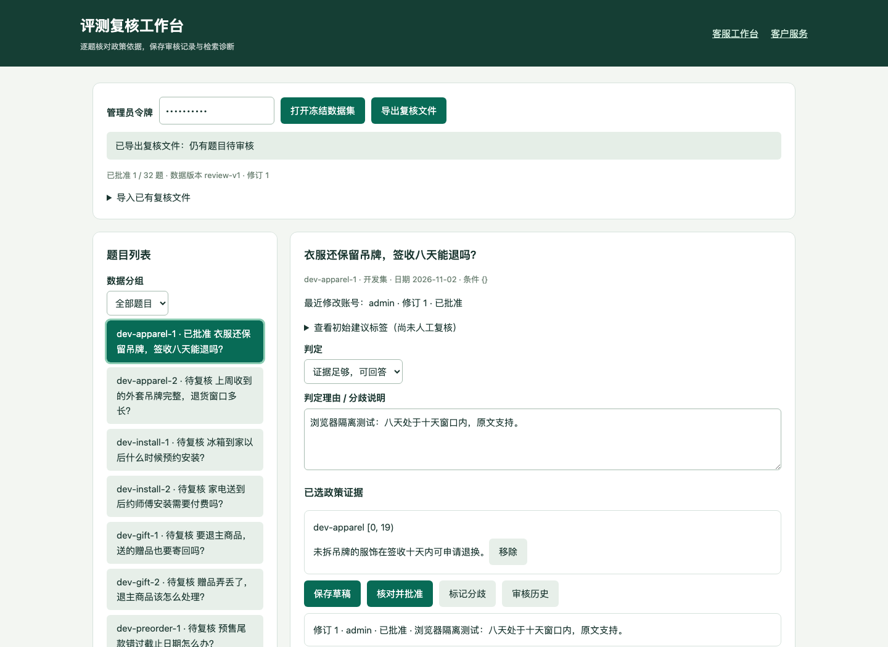

# 人工复核工作台

[文档中心](../README.md) · [当前验收](../evaluation/acceptance.md)

用于逐题核对政策、保存原文证据与审核历史。数据集冻结规则和 holdout 门禁见[离线评测协议](../evaluation/offline-review.md)，排序诊断见[检索实验](../evaluation/retrieval-experiments.md)。

## 启动与审核

```bash
python -m app.scripts.demo_stack --directory app/sessions/review-demo
```

打开终端打印的 `/review`，输入 `demo-admin`。此令牌仅用于本机可丢弃演示；实际部署使用现有管理员认证，接口要求 `maintenance:run` 权限。生产维护者应先执行 `python -m app.scripts.manage_migrations upgrade`，新增版本 `20261105_0007` 包含 `review_projects`、`review_annotations`、`review_events`，不修改既有业务表。



*截图来自自动化浏览器的可丢弃测试库；其中批准记录不计入项目真实人工复核进度。*

1. 打开冻结数据集，选择题目。先核对问题、日期、适用条件与原始政策；初始建议标签折叠显示，避免直接照抄。
2. 点击“采用此政策”保存原文及 `[start, end)` 字符定位（按 Unicode 字符计数），填写结果判定与理由。当前界面引用政策全文，API 支持原文片段定位。
3. 保存草稿、核对并批准，或标记分歧。批准必须提供非空理由；除 `no_evidence` 外，必须为所有 gold 政策提供精确匹配的原文证据。无证据结论必须清空 gold 并说明原因。
4. “审核历史”查看认证账号、修订与理由。两个窗口编辑同一旧版本时，仅第一个保存成功；另一个返回 `REVIEW_VERSION_CONFLICT`，重新选择题目读取新版本，再人工合并意见。
5. 导出 JSON，保存原始文件。导出绑定题目和文档哈希，保留账号、UTC 时间、修订、证据与批准状态。**导入只生成草稿**，不继承外部文件声称的身份或批准；完整验证后同事务写入全部 32 题。导入前先导出备份，已有审核历史保留。

项目与记录按配置中的 tenant 隔离；这不代表整套旧业务系统已成为共享库 SaaS。令牌不存入浏览器 localStorage；切换令牌会清空页面资料。审计历史在应用中仅追加，没有修改接口；它不等同于防数据库管理员篡改的签名日志。共享管理员令牌只能标识共享账号，真实组织需使用独立身份。

有复核项目或历史记录时，迁移降级会返回 `REVIEW_DOWNGRADE_BLOCKED`。应保留备份及审计数据，不能为降级随意清空真实审核表。CI 的降级测试仅清理专用 smoke 租户的数据。

## 完成审核后

导出完整审核文件，按[离线评测协议](../evaluation/offline-review.md)核验覆盖与哈希，再决定是否执行保留集。当前仓库材料尚未完成真实人工复核；自动化测试中的批准记录不计入该进度。
